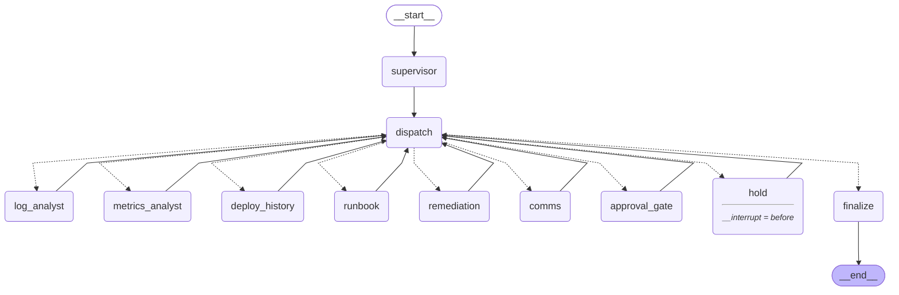

# The compiled graph

Generated from the compiled LangGraph (`graph.get_graph().draw_mermaid()`) by `make graph`; a test fails if
this file is stale. Solid arrows are plain edges, dotted arrows are the conditional edge out of `dispatch`
(its `route` function returns a list of `Send`s, one per ready task, or `hold` / `finalize`).

| Node | Role |
|---|---|
| `supervisor` | planner: alert -> validated task DAG (deterministic fallback plan if the model's plan is invalid) |
| `dispatch` | scheduler + join: folds queued human edits into the state, enforces budgets/cancellation, cascades upstream failures, marks breakpoints; its conditional edge fans the plan out with `Send` |
| `log_analyst`, `metrics_analyst`, `deploy_history`, `runbook`, `remediation`, `comms` | the specialist agents; one `Send` per ready task, so independent tasks run in the same superstep, concurrently |
| `approval_gate` | `interrupt()`s until a human approves / rejects / edits; mutating actions execute only after it resumes |
| `hold` | no-op node compiled with `interrupt_before`: the graph parks here when the run is paused or only breakpoint-held tasks remain |
| `finalize` | run status (completed / degraded / failed) or abort bookkeeping (budget, cancel) |

A run is one LangGraph *thread* (`thread_id == run_id`); the checkpointer persists the state after every superstep.
